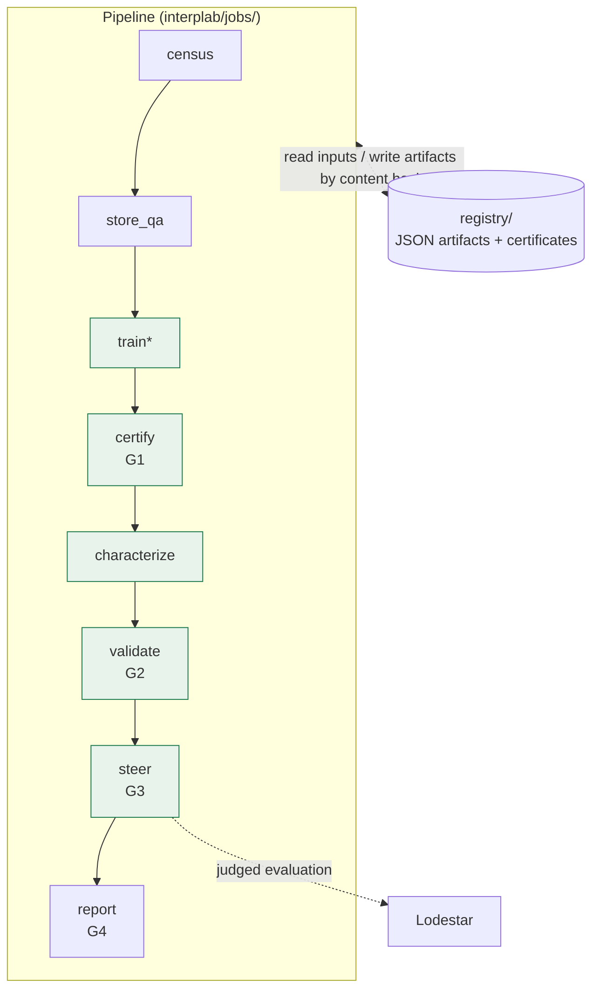

<p align="center">
  
</p>

<p align="center">
  <a href="https://github.com/mo-dev-x/Interlab/actions/workflows/ci.yml"></a>
  
  <a href="LICENSE"></a>
</p>

# Interlab

**Interlab is a research laboratory in a repository.** It finds human-readable concepts inside an open-source language model, checks that they are real, and records every result so it can be audited later. It was built to reproduce Anthropic's "Golden Gate Claude" experiment, where turning up one internal feature makes a model talk about one concept, on an open-weight model instead of a closed one.

**In technical terms:** Interlab is a content-addressed pipeline for training, certifying and causally validating sparse autoencoders (SAEs) on Qwen2.5-14B and Qwen2.5-14B-Instruct, extended later to Gemma-3-12B with Gemma Scope 2. Each stage reads the previous stage's artifacts from a registry and writes its own, validated against a JSON Schema and identified by its content hash. Four gates (certification, feature validation, intervention, report) decide whether a claim is stamped `CERTIFIED` or `DRAFT`. GPU stages run as SLURM jobs.

> Part of a three-repo interpretability toolkit, see [Related projects](#related-projects).

---

## Key features

- **Content-addressed registry.** Every checkpoint, certificate, characterization and judged intervention is stored as a small JSON envelope under `registry/`, keyed by the hash of its canonical JSON, much as git keys objects. Artifacts refer to their inputs by hash, so any claim can be traced back to the corpus and checkpoint that produced it.
- **Gated pipeline.** The stages run census → store QA → train (existing checkpoints are registered through `backfill_checkpoint`) → certify (**G1**) → characterize → validate (**G2**) → steer (**G3**) → report (**G4**). A claim whose certificate chain is incomplete cannot be stamped `CERTIFIED`. Exploration is never blocked. Only claims are.
- **One interface for every job.** A thin `scripts/<job>.py` wrapper validates its YAML config against `schemas/configs/<job>_v1.schema.json` before any heavy work starts. It then opens a `RunCard` and finalizes it, even on failure. Exit codes are the contract: `0` success, `2` gate ran red, `3` missing or invalid input, `4` environment failure.
- **SAE certification (G1).** Cross-entropy loss recovered, fraction of variance unexplained and dead-feature fraction, measured on a held-out evaluation slice and banded into a report card.
- **Feature validation (G2).** Specificity, sensitivity and rate-matched selectivity controls for each feature, run against a researcher-authored concept battery (`data/concepts/`).
- **One shared intervention library.** Steering and ablation hooks live in `interplab/interventions/`, so every experiment uses the same implementation of "steering".
- **Shared statistics.** Bootstrap confidence intervals, Benjamini–Hochberg FDR correction, seed variance and effect sizes in `interplab/stats/`. The test suite checks them against pinned reference values that were generated independently with SciPy.
- **Judged evaluation through [Lodestar](https://github.com/mo-dev-x/lodestar).** Lodestar is used as a standalone dependency and is not copied into this repo.
- **Research-integrity tooling.** Tracked git hooks (`scripts/legacy/githooks/`) block commits that would leak calibration-reserved feature indices or adjudication tallies, in either the files or the commit message.

## What it produced

These are summaries of [`reports/internship_report.md`](reports/internship_report.md), which has the full methods, numbers and caveats.

- **Reproduction result.** Feature 9056 on the instruct-model SAE (`rwu04lpb`, layer 28) reproduces the Golden Gate Claude identity-substitution effect on Qwen2.5-14B-Instruct. Clamped at steering scale 55, it produces coherent generations that open with lines like *"I'm an aged cheese..."*. Under LLM-judged evaluation (judge `claude-sonnet-4-5`) they score 5.38 for coherence and 5.50 for concept relevance.
- **A triangulated feature-quality method.** Survey labels, judged steering sweeps and rate-matched selectivity controls agree on the same feature ranking (9056 > 47735 > 44189).
- **Negative results reported as findings:**
  - No clean "poutine" feature was found in sixteen attempts across two checkpoints, because the training corpus barely covered the concept.
  - An apparent Montreal/Quebec feature turned out to be bilingually entangled, which corrects the project's own earlier claim.
  - A base-model SAE does not transfer to the instruct model.
  - Steering an entangled feature breaks fluency before the text becomes on-topic.
- **Cross-model and necessity arms (August 2026).**
  - **Gemma-3-12B:** a dose–response sweep of 1,736 records over 54 dose-cells produced no usable direction for the model comparison.
  - **Necessity:** in a nine-feature ablation arm, one feature (2048) gave a clear causal result that survives Bonferroni correction.
- **Methodological finding.** The report's main conclusion: at four separate stages of the analysis, an unstated analyst choice moved the reported answer by more than the effect being reported.
- **Certified checkpoints.** The four SAE checkpoints are certified on a held-out 10M-token slice, with CE recovered between 0.9785 and 0.9938 and a dead-feature fraction of at most 0.0020. They are pinned in `registry/sae_certificate/`.

None of this has been shown to generalize beyond the models named above.

## Architecture



Green stages run on GPU through SLURM. The others run locally or against an API. \*`train` is researcher-gated, and existing checkpoints enter the chain through `backfill_checkpoint`.

Each stage is one module in `interplab/jobs/`. Each artifact type has a JSON Schema in `schemas/`. The full design is in [`docs/infrastructure_architecture.md`](docs/infrastructure_architecture.md) and [`docs/implementation_blueprint.md`](docs/implementation_blueprint.md). The long-term research plan is in [`docs/research_program.md`](docs/research_program.md).

## Tech stack

Python 3.11+ · PyTorch · Hugging Face Transformers · TransformerLens · [SAELens](https://github.com/jbloomAI/SAELens) (SAE training) · Pydantic v2 · `jsonschema` · NumPy / scikit-learn / matplotlib · Weights & Biases · [uv](https://docs.astral.sh/uv/) (locked dependencies) · SLURM (GPU jobs) · pytest + Ruff, with GitHub Actions CI.

## Quickstart

The project uses `uv`, with `pyproject.toml` and `uv.lock` as the single source of truth for dependencies. Locally and in CI, `uv` installs the **CPU** build of PyTorch. The cluster profile (`slurm/setup_env.sh`) installs CUDA PyTorch separately.

```bash
git clone https://github.com/mo-dev-x/Interlab.git
cd Interlab
uv sync --extra dev        # --extra dev adds pytest/ruff; a bare `uv sync` is runtime-only
uv run pytest              # per-commit suite, CPU-only, no model weights needed
```

Every pipeline stage has the same interface:

```bash
uv run python scripts/<job>.py --config path/to/<job>.yaml
# e.g. G1 certification of the instruct-model SAE:
uv run python scripts/certify.py --config configs/certify/rwu04lpb.yaml
```

`census`, `store_qa`, `report` and `sync_registry` run locally or against an API. The GPU stages (`certify`, `characterize`, `validate`, `steer`) need model and SAE weights and have SLURM launchers in `slurm/`, for example `slurm/launch_certify.sh`. Example configs for real runs are in `configs/`.

## Project structure

```
interplab/            the Python package (note the spelling: interplab)
├── core/                envelope, hashing, canonical JSON, URIs, config loading, schema validation
├── corpus/              corpus manifests, concept battery, census
├── store_qa/            activation-store QA
├── certification/       SAE certification: metrics, bands, report cards (G1)
├── characterization/    feature indexing, search API, dashboards
├── validation/          per-feature specificity / sensitivity / selectivity (G2)
├── interventions/       the shared steering/ablation hook library
├── evaluation/          blinding, capability, compat map, judged-evaluation boundary
├── reports/             claim-chain assembly, statistics, renderers (G4)
├── stats/               shared statistics: bootstrap CIs, FDR correction
├── registry/            RunCard + registry put/get/find
└── jobs/                one module per pipeline stage (the real entry points)
scripts/              thin CLI wrappers around interplab.jobs.*; scripts/legacy/ holds the
                      pre-refactor experiment scripts that produced the report's results;
                      scripts/final_pairing/ holds the Gemma/Qwen discovery and gate code
configs/              YAML/JSON job configs used for real runs
schemas/              JSON Schema for every artifact type and job config
registry/             the git-tracked artifact registry (small JSON only, no weights)
data/concepts/        researcher-authored concept battery (probe/control sentences)
conformance/          frozen conformance fixtures and reports
slurm/                SLURM launchers and cluster environment setup
reports/              the internship report, pre-registrations, adjudication ledgers, evidence inventories
docs/                 architecture, blueprint, research programme, dated findings notes
results/              per-job result records (chain-of-custody, inventories, logs)
tests/                pytest suite, with fixtures/ and golden/ reference values
```

## Testing

```bash
uv run pytest                                   # per-commit suite (excludes tests marked nightly)
uv run pytest -m nightly                        # cluster/real-artifact tests only
uv run ruff check interplab tests scripts/*.py scripts/final_pairing/*.py data/concepts/*.py
```

CI ([`.github/workflows/ci.yml`](.github/workflows/ci.yml)) runs Ruff and the per-commit suite on every push and pull request. It uses a full-history checkout, because several loaders read frozen bytes from pinned git revisions. CI never launches SLURM jobs.

To install the research-integrity hooks on a fresh clone:

```bash
cp scripts/legacy/githooks/pre-commit scripts/legacy/githooks/commit-msg .git/hooks/
chmod +x .git/hooks/pre-commit .git/hooks/commit-msg
```

## Roadmap and limitations

- **Single model family for the main result.** The steering reproduction holds for Qwen2.5-14B(-Instruct) only. The Gemma-3-12B arm did not give a usable model-comparison direction.
- **The `train` job has not been built yet.** `slurm/launch_train.sh` already exists, but `interplab.jobs.train` and `scripts/train.py` do not. Existing checkpoints are registered with `scripts/backfill_checkpoint.py`.
- **Not every result went through the refactored chain.** The results in the report were produced by the pre-refactor scripts in `scripts/legacy/`. The refactored `interplab.jobs.*` chain is the path going forward.
- **GPU stages need a SLURM cluster** and locally staged weights. Model weights are not distributed with this repo.
- **Judged scores depend on an LLM judge** (through Lodestar), and their validity rests on that judge's validation.
- **Roadmap.** [`docs/research_program.md`](docs/research_program.md) sets out "Grounded Interpretability", a longer-term plan to make interpretability claims decidable rather than judged by eye. [`docs/execution_roadmap.md`](docs/execution_roadmap.md) tracks execution.

## Related projects

Interlab is one of three repositories built during a mechanistic-interpretability research internship at IID:

| Repository | Role |
|---|---|
| **Interlab** (this repo) | The laboratory. It trains, certifies and causally validates sparse autoencoders, and records every result under a content hash. |
| [**Lodestar**](https://github.com/mo-dev-x/lodestar) | The judge. It scores steered generations with an LLM judge, validates the judge itself, and reports the results. Interlab's judged evaluations run through it. |
| [**SAE Concept Lab**](https://github.com/mo-dev-x/sae-concept-lab) | The demo. A Gradio app for turning one SAE feature up or down while chatting with Gemma or Qwen. |

## Key references

- Bricken et al. (2023), [Towards Monosemanticity](https://transformer-circuits.pub/2023/monosemantic-features)
- Templeton et al. (2024), [Scaling Monosemanticity](https://transformer-circuits.pub/2024/scaling-monosemanticity). This is the Golden Gate Claude demonstration that this project reproduces.
- Ameisen et al. (2025), [Circuit Tracing](https://transformer-circuits.pub/2025/attribution-graphs)
- [SAELens](https://github.com/jbloomAI/SAELens), the SAE training library this project builds on

## License and citation

MIT licensed, see [`LICENSE`](LICENSE). Citation metadata is in [`CITATION.cff`](CITATION.cff):

```bibtex
@software{el_yaakoubi_interlab_2026,
  author  = {El Yaakoubi, Mohamed El Yazid},
  title   = {Interlab: A certificate-based laboratory for sparse-autoencoder interpretability},
  year    = {2026},
  url     = {https://github.com/mo-dev-x/Interlab}
}
```

The main scientific write-up is [`reports/internship_report.md`](reports/internship_report.md) (Mohamed El Yazid, IID, July 2026, revised August 2026).

## Author

Mohamed El Yazid El Yaakoubi, Software Engineering student at Université Laval and Research Intern in Mechanistic Interpretability at IID. [GitHub](https://github.com/mo-dev-x) · [LinkedIn](https://www.linkedin.com/in/mohamed-el-yazid-el-yaakoubi/)
